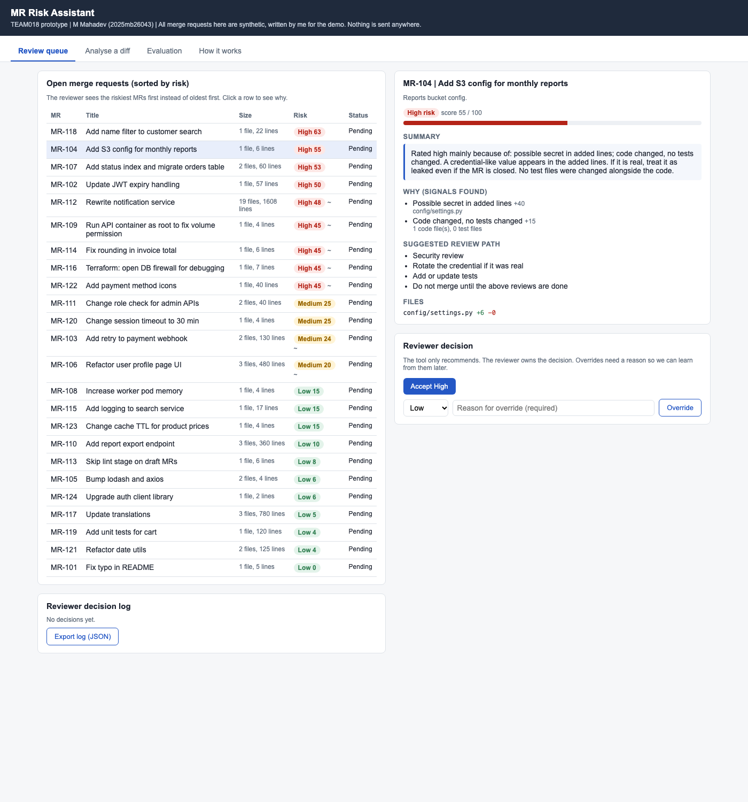
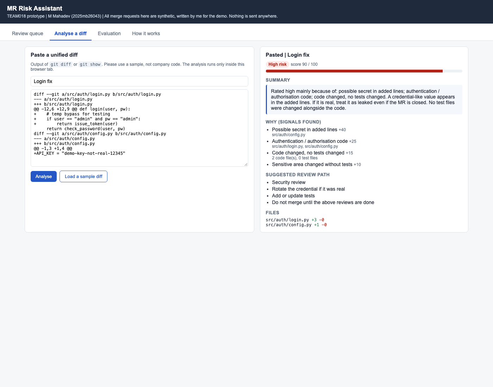
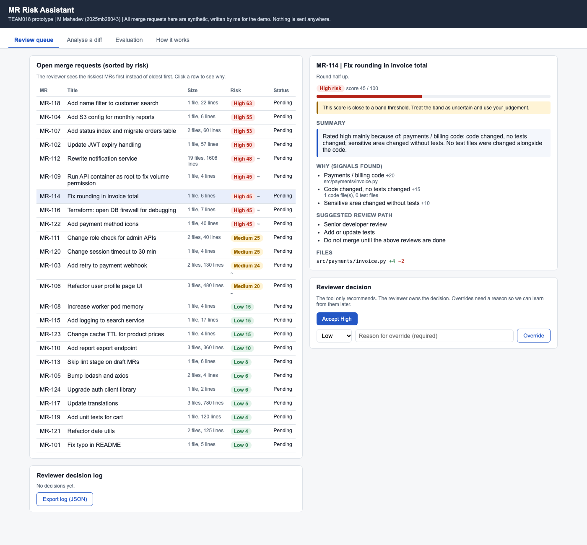
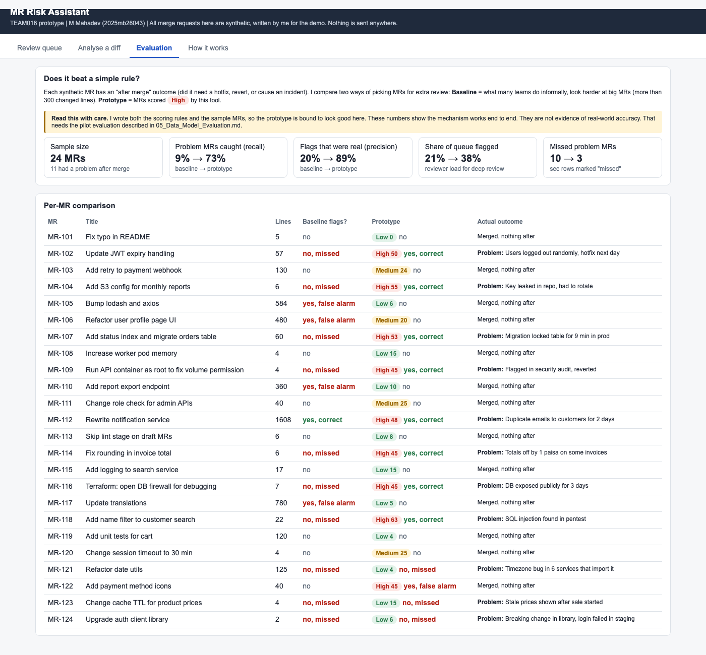

# 08 Prototype / MVP

## Prototype type

Offline single-page web app: [`prototype/index.html`](prototype/index.html). Open it in any modern browser. No install, no server, no network calls, no login.

## How to run

1. Download or clone this repository.
2. Open `prototype/index.html` in Chrome, Edge, Firefox or Safari.
3. That's it.

## Demo script (about 5 minutes)

1. **Review queue tab.** Point out that the queue is sorted by risk, not by age. The top of the list is the secret leak, the SQL injection and the migration. The README fix and translations are at the bottom.
2. Click **MR-104** (S3 config). Show the hard-rule hit: "Possible secret in added lines". Point out it is High regardless of size (only 6 lines).
3. Click **MR-114** (invoice rounding). Show the "uncertain" warning because the score is right at the threshold. Accept it.
4. Click **MR-122** (payment icons). It's High only because the path has `payments`. Override it to Low with the reason "UI only, no logic". Show the decision log and override rate updating.
5. **Analyse a diff tab.** Click "Load a sample diff", then Analyse. It picks up the hardcoded login bypass area and the API key.
6. **Evaluation tab.** Show baseline vs prototype. Then scroll to the misses (MR-121, 123, 124) and explain why the tool can't see them. Read the caveat box out loud.
7. **How it works tab.** Show the full rule table and the "deliberately not used" section.

## What it demonstrates

- The core decision loop: MR comes in, gets a score, band and reasons, reviewer accepts or overrides.
- That reasons can be specific (file, line) and not just a number.
- Uncertainty handling (borderline scores) and hard rules that can't be outvoted.
- Human override with reason capture, and the override rate as a live guardrail metric.
- A fair comparison against the obvious baseline, including the cases where the prototype fails.

## AI role

In the prototype:
- The **risk score** is a weighted rule set. It stands in for the ML model I would train in the pilot, and it will remain as the baseline and fallback.
- The **summary** text is generated from templates based on the signals found. It stands in for the LLM explanation.

I chose not to call a real LLM in the prototype for two reasons: it would need an API key in a public repo, and sending sample code to an external service is the exact privacy question the pilot has to settle first. The interaction (score, reasons, explanation, override) is what the prototype needs to prove, and that works the same either way.

## What it does not yet prove

- **Real-world accuracy.** I wrote both the rules and the 24 sample MRs, so the evaluation numbers are optimistic by design.
- That a learned model beats the rules. There is no trained model yet.
- That an LLM explanation is accurate and actually helps reviewers.
- Integration with GitLab / GitHub (showing the panel inside the MR, webhooks).
- That reviewers will trust and use it over weeks, not just in a demo.
- Cost and latency at real volume.

## Screenshots

| Review queue, sorted by risk | Analyse a pasted diff |
|---|---|
|  |  |
| **Borderline score with uncertainty warning** | **Evaluation against the size baseline** |
|  |  |

## Links

- Repository: https://github.com/MAIP2026July/TEAM018
- Prototype: [`prototype/index.html`](prototype/index.html) (open locally; can also be served with GitHub Pages)
- Screenshots: [`Appendix/Screenshots/`](Appendix/Screenshots/)
